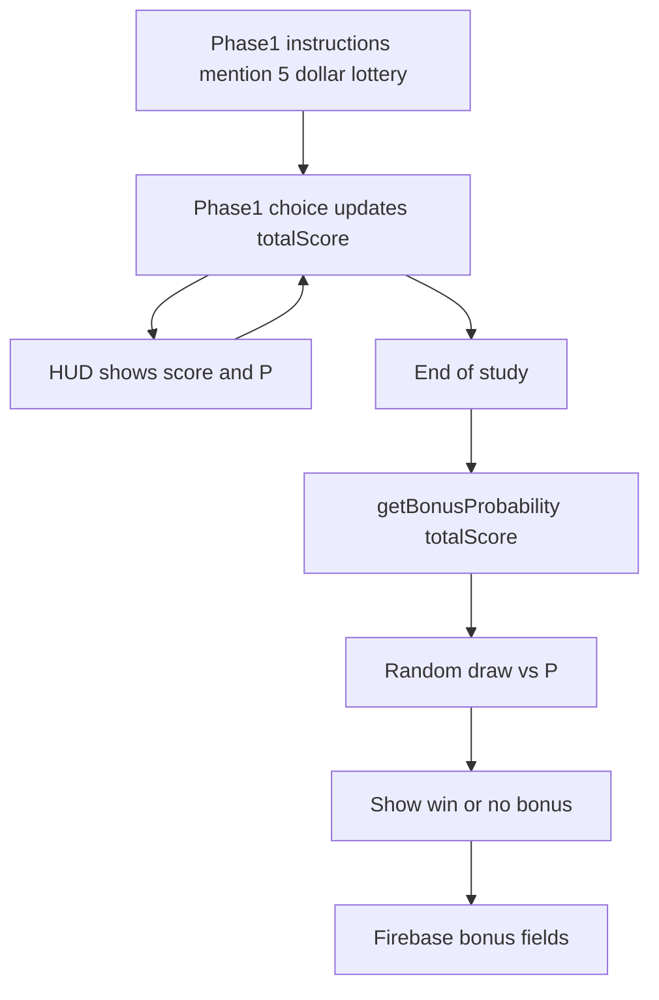

# Plan: $5 Bonus Lottery + Live Probability HUD

## Goal
Replace the current deterministic `points × $0.01` bonus with a **Phase-1-score → win probability → $5 lottery**, announce it before Phase 1, and show a live **bonus chance** indicator during Phase 1.

Reference ladder: [Bonus_Probability_Schedule.md](Bonus_Probability_Schedule.md).

## Locked decisions
- Probability uses **bad-face trials avoided** \(m\) (chose good on a bad-present Phase 1 trial), not Phase 1 point total and not Phase 2.
- Config A: 48 bad-present trials; \(m \le 36\) (≈ random) → 0%; \(m = 45\) → 90%; \(m \ge 46\) → 100% (see Bonus_Probability_Schedule.md).
- Bonus amount if won: **$5.00** (flat).
- Draw once at **study end** (before/with final score screen): `Math.random() < p`.
- Live HUD during **Phase 1 only** (hide or leave frozen after Phase 1 ends).
- HUD placement: **fixed at the bottom of the screen** (bottom-center), shows Score · Avoided m/48 · Bonus chance.
- End screens and Firebase store `bad_trials_avoided`, `bonus_probability`, `bonus_won`, `bonus_usd`.

## Phases affected
- Consent (short mention)
- Phase 1 instructions + Phase 1 trials (HUD)
- End survey / finish screens + Firebase payload
- Not Phase 2 trial logic (score still recorded; not used for `p`)

## Implementation steps

### 1. Config + helper
**[src/utils/config.js](../src/utils/config.js)**
- Add `BONUS_AMOUNT_USD: 5`
- Add `BONUS_PROBABILITY_LADDER`: ordered thresholds from the schedule doc, e.g.  
  `{ minScore: -91.2, p: 0.0 }, …, { minScore: 4.8, p: 1.0 }`
- Keep or deprecate `POINTS_TO_DOLLARS` (unused for paid bonus once lottery ships; leave commented if needed for legacy)

**New [src/utils/bonus.js](../src/utils/bonus.js)**
- `getBonusProbability(phase1Score)` → `p` in `[0, 1]`
- `drawBonus(p)` → `{ won: boolean, amount_usd: number }`
- `formatBonusPercent(p)` → display string e.g. `"80%"`

### 2. Tell participants beforehand
**[src/experiment.js](../src/experiment.js)** Phase 1 instructions (both conditions), one short paragraph:

> Your Phase 1 points determine your chance of winning a **$5 bonus** at the end. Higher scores mean a higher chance. The bonus is drawn at random using that probability.

**[assets/informed_consent/consent_form.html](../assets/informed_consent/consent_form.html)** — one matching sentence in “About This Study”.

Mirror instruction line in **[src/experiment_demo.js](../src/experiment_demo.js)**.

### 3. Live HUD (Phase 1)
- Mount a **fixed bottom** status chip/bar (update `.score-display` in [src/styles/main.scss](../src/styles/main.scss): `position: fixed; bottom: …; left/right or centered`; compact, low-contrast; clear of face click targets):

  `Score: N`  
  `Bonus chance: P%`

- Rationale: top of screen already has the jsPsych progress bar and response timer; bottom reads as ongoing status without competing with faces or the countdown.
- Create/update on Phase 1 start (`on_load` / first choice `on_start`); refresh in choice `on_finish` after `totalScore` updates.
- Same position every trial (constant presence through Phase 1).
- On Phase 1 complete (or Phase 2 break): remove HUD or stop updating.
- Do not show the EV table or “blocks avoided” framing to participants.

### 4. End-of-study lottery + display
After Phase 1 score is final (at end-survey thank-you / debug finish, before save):
- `bonus_probability = getBonusProbability(totalScore)`
- `bonus_draw = drawBonus(bonus_probability)`
- Show: Phase 1 score, Phase 2 score, **bonus chance**, **Won $5 / No bonus** (and `$5.00` or `$0.00`).
- Remove `totalScore + phase2Score) * POINTS_TO_DOLLARS` from thank-you and debug finish screens.

### 5. Data logging
In Firebase payload (and trial-level if useful):
- `bonus_probability`
- `bonus_won` (boolean)
- `bonus_usd` (5 or 0)
- `phase1_score` (already present)
- Optionally log `bonus_probability` on each Phase 1 choice row for trajectory analyses (same helper).

### 6. Verify
- Unit-style checks for ladder edges (`−91.3`, `−91.2`, `−4.8`, `4.8`, `24`).
- Smoke: `?debug=true&c=EXE` — HUD moves with score; end screen shows lottery result.
- Redeploy only when requested after commit.

## Flow

